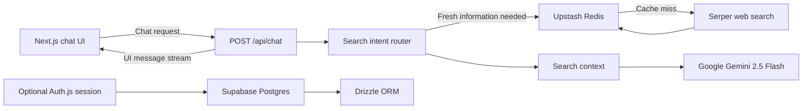

# DeepSearch

> A focused deep-search experience for asking questions, finding current information, and receiving readable answers with sources.

DeepSearch is a full-stack Next.js implementation of the research-oriented conversational interfaces popularized by products such as **Perplexity**, **Gemini**, and **ChatGPT**. It combines a large language model with live web retrieval, cached search results, streaming responses, and optional user authentication in a compact, extensible codebase.

The project is designed as both a usable AI search application and a foundation for building a more advanced deep-research agent.

## Product overview

DeepSearch turns a natural-language question into a conversational answer:

1. A user submits a prompt. Discord sign-in remains available but is not currently required.
2. The server extracts the latest user message.
3. Search intent is detected automatically, or explicitly with `/web`, `web:`, or `search:`.
4. Current search results are retrieved from Serper when appropriate.
5. Search context is supplied to Google Gemini.
6. Gemini streams a Markdown answer back to the browser.
7. When web context is used, the answer includes a short Sources section with links.

The interface supports normal knowledge questions as well as questions that benefit from fresh information, including news, prices, sports, weather, schedules, rankings, releases, and other time-sensitive topics.

## Highlights

- **Conversational AI** powered by Google Gemini 2.5 Flash
- **Live web search** through the Serper API
- **Automatic search routing** based on query intent and length
- **Explicit web search controls** with `/web`, `web:`, and `search:` prefixes
- **Streaming responses** for a fast, responsive chat experience
- **Markdown rendering** for lists, links, code, and formatted answers
- **Source-aware answers** with clickable search-result links
- **Discord authentication** through Auth.js / NextAuth
- **Postgres persistence** for users, accounts, sessions, and verification tokens
- **Redis caching** for Serper responses with a six-hour expiration
- **Typed configuration validation** with `@t3-oss/env-nextjs` and Zod
- **Responsive dark interface** built with Tailwind CSS and Geist
- **Type-safe database access** with Drizzle ORM

## Architecture



### Request lifecycle

The main request path lives in [`src/app/api/chat/route.ts`](./src/app/api/chat/route.ts):

1. **Message extraction** — the latest non-empty user text is selected from the UI message history.
2. **Directive parsing** — search prefixes are removed and treated as an explicit search request.
3. **Intent detection** — time-sensitive terms or a longer research-style query trigger web search.
4. **Retrieval** — up to five organic Serper results are fetched and formatted as model context.
5. **Generation** — the conversation and optional web context are passed to Gemini.
6. **Streaming** — the AI SDK returns a UI message stream to the client.

Search requests are wrapped by [`src/server/redis/redis.ts`](./src/server/redis/redis.ts). Cache reads and writes are best-effort: a Redis failure does not prevent a live Serper request, while successful results are cached for six hours.

## Technology stack

| Layer | Technology |
| --- | --- |
| Application | Next.js 15 App Router |
| Language | TypeScript |
| UI | React 18, Tailwind CSS, Geist |
| AI orchestration | Vercel AI SDK |
| Model provider | Google Gemini 2.5 Flash |
| Web retrieval | Serper |
| Authentication | Auth.js / NextAuth with Discord |
| Database | Supabase Postgres |
| ORM | Drizzle ORM |
| Cache | Upstash Redis |
| Validation | Zod and `@t3-oss/env-nextjs` |
| Quality | Biome, TypeScript, Vitest |
| Package manager | pnpm 9+ |

## Repository structure

```text
.
├── drizzle/                  # Drizzle migration metadata
├── public/                   # Static assets
├── src/
│   ├── app/
│   │   ├── api/chat/         # Anonymous streaming chat endpoint
│   │   ├── chat.tsx          # Client chat experience
│   │   ├── layout.tsx        # Root layout and metadata
│   │   └── page.tsx          # Application shell and sidebar
│   ├── components/           # Chat, auth, and error UI
│   ├── server/
│   │   ├── auth/             # Auth.js configuration and session helpers
│   │   ├── db/               # Drizzle client and Postgres schema
│   │   └── redis/            # Upstash client and cache helper
│   ├── env.js                # Runtime environment validation
│   ├── model.ts              # Gemini model configuration
│   └── serper.ts             # Cached Serper search integration
├── drizzle.config.ts
├── next.config.js
├── package.json
└── tsconfig.json
```

## Requirements

- Node.js 20 or later
- pnpm 9 or later
- A Supabase project with a Postgres connection string
- An Upstash Redis database
- A Google AI API key with access to Gemini
- A Serper API key
- A Discord OAuth application

## Local setup

### 1. Install dependencies

```bash
pnpm install
```

### 2. Configure environment variables

Create a `.env` file in the project root:

```dotenv
DATABASE_URL="postgresql://..."
UPSTASH_REDIS_REST_URL="https://..."
UPSTASH_REDIS_REST_TOKEN="..."

AUTH_SECRET="replace-with-a-long-random-secret"
AUTH_DISCORD_ID="your-discord-client-id"
AUTH_DISCORD_SECRET="your-discord-client-secret"

GOOGLE_GENERATIVE_AI_API_KEY="your-google-ai-api-key"
SERPER_API_KEY="your-serper-api-key"
```

Never commit `.env` or expose API keys in client-side code. Environment variables are validated at runtime by [`src/env.js`](./src/env.js).

For Discord OAuth, configure the callback URL for your environment:

```text
http://localhost:3000/api/auth/callback/discord
```

Use the equivalent HTTPS URL in production.

### 3. Apply the database schema

```bash
pnpm db:push
```

The current schema stores Auth.js users, linked provider accounts, sessions, and verification tokens. Chat history persistence can be added independently without changing the streaming API contract.

### 4. Start the development server

```bash
pnpm dev
```

Open [http://localhost:3000](http://localhost:3000).

On Windows PowerShell systems where `pnpm.ps1` is blocked by execution policy, use:

```powershell
pnpm.cmd dev
```

## Commands

| Command | Purpose |
| --- | --- |
| `pnpm dev` | Start the Next.js development server with Turbopack |
| `pnpm build` | Create a production build |
| `pnpm start` | Serve a production build |
| `pnpm check` | Run Biome checks and TypeScript validation |
| `pnpm lint` | Run Biome checks |
| `pnpm format` | Format the repository with Biome |
| `pnpm format:check` | Verify formatting without writing changes |
| `pnpm typecheck` | Run TypeScript without emitting files |
| `pnpm db:generate` | Generate Drizzle migration files |
| `pnpm db:migrate` | Apply Drizzle migrations |
| `pnpm db:push` | Push the schema directly to the database |
| `pnpm db:studio` | Open Drizzle Studio |
| `node -r dotenv/config test-redis.js` | Verify Upstash Redis connectivity |

## Search behavior

DeepSearch intentionally supports both automatic and explicit retrieval:

| Input | Behavior |
| --- | --- |
| `/web latest developments in quantum computing` | Always search the web |
| `search: current EUR to USD rate` | Always search the web |
| `web: what happened today in technology?` | Always search the web |
| `What is the history of the Roman Empire?` | Answer without search unless intent rules trigger it |
| A long research-style question | Search automatically |
| A question containing current-event terms | Search automatically |

Search results are not treated as unquestionable truth. They are context supplied to the model, and users should follow the source links and independently verify important claims.

## Security and reliability

- Chat is currently available without authentication; Discord authentication remains available for later use.
- API credentials remain server-side and are validated before use.
- External links rendered in messages open with `noopener noreferrer`.
- Search requests honor the incoming request abort signal.
- Redis is an optimization, not a required source of truth.
- Search failures are surfaced to the server logs and the model can still answer without web context.
- Production deployments should use HTTPS, a strong `AUTH_SECRET`, restricted OAuth redirect URLs, and secret storage provided by the hosting platform.

## Current scope

DeepSearch is an intentionally small but complete foundation. It currently provides:

- One active conversational workspace
- Optional Discord sign-in
- Streaming Gemini responses
- Automatic or forced web retrieval
- Search-result source links
- Auth.js data persistence

The sidebar and chat state are currently lightweight application scaffolding; durable per-user conversation history and multiple persisted chat threads are natural next steps rather than assumptions about the current implementation.

## Roadmap

Potential extensions for a deeper research workflow include:

- Persisted conversations, titles, and message history
- Multi-step research plans and query decomposition
- Parallel searches across multiple sources
- Source quality, freshness, and citation ranking
- Follow-up searches when evidence is incomplete
- Domain filters, date filters, and source controls
- Structured answer modes for reports, comparisons, and briefings
- Usage limits, observability, and per-user cost controls
- Additional model providers and model selection
- Evaluation datasets for answer quality and citation faithfulness

## Contributing

1. Create a feature branch.
2. Make a focused change that follows the existing TypeScript and server/client boundaries.
3. Run `pnpm check`.
4. Update this README when setup, behavior, or architecture changes.
5. Open a pull request with a concise description and validation notes.

## License

No license has been declared yet. Add a license before distributing or deploying DeepSearch as an open-source product.
